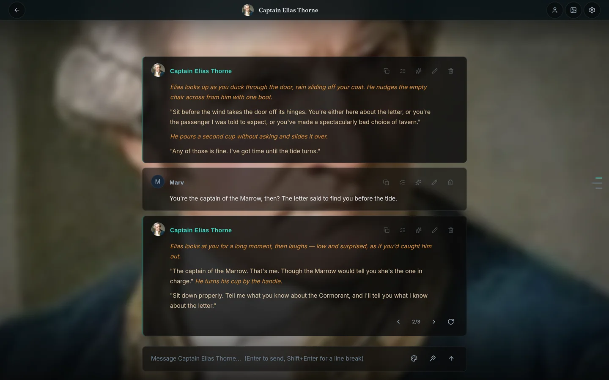

# Charon

**A private home for your AI characters.**

Charon is a self-hosted chat app for stories and roleplay. Bring the character cards you already have, connect your own AI provider (or a model running on your machine), and keep every conversation — including every branch of it — on your own computer.

No cloud account. No subscription. No telemetry. One SQLite file you can copy.



---

## What makes it different

**Every reply is a branch.** Swipe to see another version of a reply and the one you had stays where it was. Regenerate, edit, or continue, and each choice becomes a path you can come back to. Nothing is overwritten.

**Your library comes with you.** Charon reads V2 and V3 PNG character cards from other apps and anywhere else that follows the card spec. Portraits, greetings, tags, and embedded lorebooks come across. You can also import world-info JSON.

**You choose the model.** OpenAI, OpenRouter, Anthropic through a proxy, vLLM, LM Studio, Ollama, or any other OpenAI-compatible endpoint. Your key is encrypted before it is stored, and it only travels to the provider you configured.

**It is a web app you host.** Run it on your desktop, a home server, or a small VPS. Open it from your laptop or phone. There is one library and one account.

---

## Install

Charon is single-user and runs on your own machine. Pick one path.

### macOS and Linux — one command

```bash
curl -fsSL https://github.com/M4Marvin/charon/releases/latest/download/install.sh | sh
```

The installer:

- checks for Node.js 22.14+ and downloads a private copy into `~/.charon/runtime` if you do not have one;
- downloads the Charon release for your OS and CPU, and verifies its SHA-256 checksum (the installer itself is served from the release asset; read it first if you prefer);
- installs everything under `~/.charon` — **no `sudo`, nothing system-wide**;
- starts Charon and opens **http://localhost:3000**.

Your data lives in `~/.charon/data`. To update later: `charon update`. To back up: `charon backup`.

Prefer to read before you run? [Download the script](https://github.com/M4Marvin/charon/blob/main/scripts/install.sh) first. It is plain POSIX shell and every step prints what it is doing.

### Windows — one command

Open **PowerShell** (not the old Command Prompt) and run:

```powershell
irm https://github.com/M4Marvin/charon/releases/latest/download/install.ps1 | iex
```

It installs under `%LOCALAPPDATA%\Charon`, needs no administrator prompt, downloads a private Node.js runtime if needed, verifies the release checksum, and starts Charon at [http://localhost:3000](http://localhost:3000).

### Docker

The prebuilt image is public on GHCR:

```bash
docker run -d --name charon --restart unless-stopped \
  -p 127.0.0.1:3000:3000 \
  -v charon-data:/app/data \
  ghcr.io/m4marvin/charon:latest
```

Open [http://localhost:3000](http://localhost:3000). Everything persists in the
`charon-data` volume. Secrets are generated inside the volume on first start;
you do not need to create any.

The published image is `linux/amd64`. On ARM, use the installer, or build the
image locally with `docker compose -f docker-compose.yml -f docker-compose.build.yml up -d --build`.

To reach it from your phone on the same network, change the port mapping to
`3000:3000` and set `APP_URL` in the service environment to the address you
will open.

### From source (contributors)

```bash
pnpm install
cp .env.example .env          # set BETTER_AUTH_SECRET and ENCRYPTION_KEY
pnpm run dev
```

Generate the two secrets with `openssl rand -hex 64` and `openssl rand -hex 32`. Migrations run automatically on first start. See [CONTRIBUTING.md](./CONTRIBUTING.md) for the architecture and commands.

---

## First five minutes

1. **Create your account.** A local username and password. No email, no verification, nothing to confirm.
2. **Connect an AI provider.** Pick a preset — OpenAI, OpenRouter, Ollama, LM Studio, and others — or enter any OpenAI-compatible endpoint. Models come from a bundled [models.dev](https://models.dev) catalog, and Charon tests the connection before saving it.
3. **Tell it who you are.** A display name and a sentence about the part you play. Optional, and editable later.
4. **Pick a character.** Three SFW starter characters are already there, with portraits — *Captain Elias Thorne*, *Dr. Margaret Finch*, and *Lucien Vane* — or drag in a PNG card of your own.
5. **Say hello.** Press Enter. The reply streams in.

The setup wizard appears on first run and only shows the steps you still need. You can reopen it from Settings later.

### Provider base URLs

Charon speaks the OpenAI chat-completions API. The setup wizard reads a bundled
[models.dev](https://models.dev) snapshot, so provider names, base URLs, and
model lists work offline. Most cloud providers need a key; local servers do not.

| Provider | Base URL | Notes |
| --- | --- | --- |
| OpenAI | `https://api.openai.com/v1` | Key required |
| OpenRouter | `https://openrouter.ai/api/v1` | Key required; good model selection |
| Ollama | `http://localhost:11434/v1` | Run `ollama serve` and pull a model first |
| LM Studio | `http://localhost:1234/v1` | Start the local server in LM Studio |
| vLLM | `http://localhost:8000/v1` | Point at your deployment |
| Anthropic | via an OpenAI-compatible proxy | Anthropic's native API is not called directly |

> **Local-model note:** choose **Ollama** or **LM Studio** and leave the API key blank. The wizard can detect the models on the default port with **Detect models**. If your server runs elsewhere, change the Base URL under **Advanced**.

---

## Chat controls

| Action | How |
| --- | --- |
| Send | Enter |
| New line | Shift + Enter |
| Swipe alternate replies | ← / → under an AI message |
| Regenerate | Circular-arrow button on the last AI message |
| Edit a message | Pencil icon, then check (Ctrl/Cmd + Enter saves, Esc cancels) |
| Impersonate | Wand icon in the composer |
| Continue | Leave the input empty and press Enter |
| Delete a branch | Trash icon on any message |
| Command menu | Ctrl + K |

---

## Characters

Drag a PNG card onto the Characters page, or use **Import PNG**. V2 and V3 cards work. The import preview shows the portrait, description, tags, greetings, and a warning if a character with the same name already exists.

Embedded lorebooks are extracted into editable standalone lorebooks. World-info JSON can be imported from the Lorebooks page.

If you are bringing data from a whole existing install, see [Import existing data](#import-existing-data).

---

## Privacy and security

- **Local by default.** Characters, chats, lorebooks, personas, settings, and uploads live in one folder: `~/.charon/data`, `%LOCALAPPDATA%\Charon\data`, or the `charon-data` Docker volume.
- **One SQLite database.** Copy the data folder to back it up. Move it to move the install.
- **Keys encrypted at rest.** Provider keys are encrypted with a per-install key before they are written to the database.
- **No analytics, no telemetry, no account on our servers.** The project has no server to send anything to.
- **Your messages go to the provider you choose.** If you use OpenAI or OpenRouter, their terms apply. If you want nothing to leave the machine, point Charon at Ollama or another local server.
- **Self-hosted interface fonts.** No request to Google Fonts or any other font CDN.

Backups:

```bash
charon backup                 # database + uploads + instance secrets, in ~/.charon/data/backups
charon stop && cp -R ~/.charon/data /path/to/backup
```

---

## FAQ

**Is this NSFW?**
No. Charon is built and presented for stories and roleplay. It ships SFW starter characters, bundles no adult content, and is not marketed as an unfiltered or adult platform. Because it runs on your machine and uses your model, what you import and write is your choice — but if you are looking for an adult platform, this is not one.

**Do I need to be technical?**
The installer is one command. After that, setup happens in the browser: account, provider, character, chat. There are no config files to edit for normal use. A desktop app with no terminal at all is on the roadmap.

**What does it cost?**
Charon is free and open source. You pay your AI provider directly, or nothing if you run a local model. There is no subscription and nothing to unlock.

**Do I need an API key?**
For real replies, yes — Charon connects to a provider rather than bundling a model. Use a key from OpenAI, OpenRouter, or a compatible service, or run Ollama / LM Studio locally.

**Does it work on my phone?**
Yes. Run Charon on a computer, publish the port, and open the computer's address from your phone's browser on the same network. One library, one account.

**Can I import my existing characters?**
Yes. V2 and V3 PNG cards, including embedded lorebooks. World-info JSON imports too.

**Which models work?**
Anything that speaks the OpenAI chat-completions API. If it has a base URL, Charon can probably talk to it.

**Where do my chats live?**
In one SQLite file plus an uploads folder, in the data directory listed above. Nothing is stored anywhere else.

**How do I update?**
`charon update` on macOS/Linux. On Windows, run `charon update` from a new terminal. Docker: `docker pull ghcr.io/m4marvin/charon:latest` and recreate the container. Your data is untouched.

**How do I uninstall?**
macOS/Linux: run the installer with `--uninstall` to remove the app and keep your data, or delete `~/.charon`. Windows: run `install.ps1 -Uninstall` or remove `%LOCALAPPDATA%\Charon`. Docker: `docker rm -f charon && docker volume rm charon-data` (the second command deletes your chats).

**Something is broken.**
Run `charon doctor`. It checks Node, the app bundle, the data directory, and `/up`. Then read [troubleshooting](./docs/user/troubleshooting.md).

---

## Import existing data

```bash
# Copy your old data into private migration storage
cp -r /path/to/old-install/public/* data/import/

# Import into the database and private uploads
pnpm run migrate
```

For installs with data under the old `public/data` path:

```bash
pnpm run prepare:migration
pnpm run migrate:image-paths
```

---

## How it works

```
Browser (React 19 + TanStack Start)
        │
        ▼
Generation ── prompt compiler, streaming jobs, tools
        │
        ▼
Tree ──────── branching messages, active path, swipes
        │
        ▼
SQLite ────── one file: characters, chats, lorebooks, settings
```

The app is a single Node process serving a TanStack Start frontend and an SSE generation endpoint. Native dependencies are `better-sqlite3` and `sharp`; both ship prebuilt binaries, so no compiler is needed on the host.

---

## Documentation

| Guide | What it covers |
| --- | --- |
| [Getting started](./docs/user/getting-started.md) | Account, wizard, first chat |
| [Chatting](./docs/user/chatting.md) | Swipe, branch, edit, impersonate, shortcuts |
| [Characters](./docs/user/characters.md) | Library, import, detail, edit |
| [Lorebooks](./docs/user/lorebooks.md) | Activation and imports |
| [Personas, scenes, presets](./docs/user/personas-scenes-presets.md) | Tuning how the AI writes |
| [Troubleshooting](./docs/user/troubleshooting.md) | Common local problems |
| [Contributing](./CONTRIBUTING.md) | Architecture, commands, conventions |

---

## Project status

Charon is actively developed by one person. The core is stable enough for daily use; the packaging and onboarding are being rebuilt for people who do not want a terminal.

Shipped in the latest release:

- one-line installers for macOS, Windows, and Linux;
- provider presets and a bundled models.dev catalog;
- a persona step, self-hosted fonts, and three portrait'd SFW starters;
- a landing page with an SFW screenshot tour.

The GHCR image is published from the same release commit. Pull
`ghcr.io/m4marvin/charon:latest`, or use the installer above.

Still planned:

- a desktop app with no Docker and no terminal;
- a no-key demo mode;
- a model-catalog refresh button (the snapshot updates with `pnpm models:sync`).

---

## Contributing

Issues and pull requests are welcome. Read [CONTRIBUTING.md](./CONTRIBUTING.md) first. The pre-commit hook runs format, lint, tests, and typecheck.

If you hit friction — a confusing error, a missing doc, a command that failed — log it with `npx frog log`. That is how the rough edges above get fixed.

---

## License

See [LICENSE](./LICENSE) and [NOTICE](./NOTICE). NOTICE records third-party asset attributions.

Character-card parsing follows the [Character Card V2/V3 specification](https://github.com/kwaroran/character-card-spec-v3). Provider and model metadata comes from [models.dev](https://models.dev). Inter, Fraunces, and JetBrains Mono are self-hosted under the SIL Open Font License. See [NOTICE](./NOTICE) for the full attributions.
